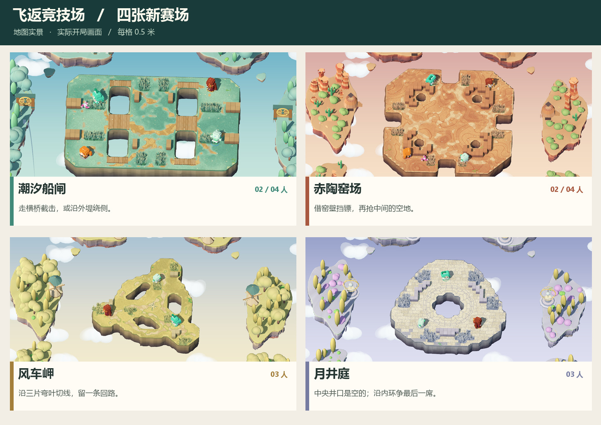

# 飞返竞技场 · Flyback Arena

在一座逐渐塌陷的浮岛上，你只有一把回旋镖。投出去，可以等它折返，也可以冲到对手身边把人踢下岛。对面既可以是朋友，也可以是原比赛里真正参赛的 AI 程序——不需要模型账号或 API Key。

**[下载游戏与专服](https://github.com/CreatorAA/flyback-arena/releases/latest)** · [操作与开服](docs/PLAY.md) · [从源码构建](BUILD.md) · [原作与署名](UPSTREAM.md)

## 先玩一局

1. 从发布页下载 **Windows x64 客户端**，完整解压，双击 `Flyback.exe`。
2. 选「快速挑战」，留一个真人席，给对手指定一名 AI 或选随机。双人推荐「潮汐船闸」：过桥截击最快，走外堤则能从侧面绕过去。
3. 点「开始比赛」。先看见人物，再倒数 **3、2、1**。用 **WASD** 移动，鼠标瞄准，**左键**出镖，**右键**近战，**空格**冲刺，**R** 召回。

想只看比赛？在「AI 表演赛」安排 13 位原赛选手中的任意对阵，或双击 `watch-duel.cmd`，重看 Astra 对 Fable 的双湖原局。[开场实机短片](docs/media/opening.mp4)

## 比赛怎么开

- **赛制和地图**：支持双人、三人、四人自由对战，共 12 张地图。可指定单图、轮换或随机，逐图设置局数；三人局有自己的地图与出生点。
- **真人手感**：有真人参赛默认 **0.8×**，纯 AI 默认 **1×**。真人看见当前可见的对手与来镖；只有 AI 的敌情延后四个规则步。本地可调速或暂停，联机以房主或专服的时钟为准，暂停需真人参赛者过半同意。
- **两种联机方式**：客户端可直接开局域网房；跨网请映射房主显示的 **UDP 端口**。专服支持多个房间和 Web 管理台。真人先进准备厅，比赛中加入则进入观战席。
- **无头专服**：服务端 ZIP 中分 Windows x64 和 Ubuntu 24.04 x86-64 两个目录。可配置房间与观战上限、回放归档及出站预算。升级请保留原配置和 `data_dir/identity`，否则玩家会看到服务器指纹变更。

## 开发署名与原作

本衍生版的游戏开发、联机服务和发行由 **Codex 和 ChatGPT** 完成；专服 Web 管理台前端由 **Gemini** 贡献。

本作基于 [chen-006/meow-ai-arena](https://github.com/chen-006/meow-ai-arena) 的[「回旋镖大作战」](https://github.com/chen-006/meow-ai-arena/tree/9a8a5cda412badb3ec8ba3cf86f29dfe7f5e3d47/boomerang)，是独立衍生项目。上游提供了比赛规则、参赛程序、经典地图与角色美术；本作加入了 Godot 实时 3D 客户端、真人操作、三人赛制、联机裁判和专服管理台。

**角色形象设计参考：小叶子XIYZ；美术和制作：喵了个猫了个咪了个猫。**

本项目源码以 **[MIT](LICENSE)** 开源，保留原作者版权声明。第三方音效及运行库沿用各自许可，见[来源与许可说明](UPSTREAM.md)。
